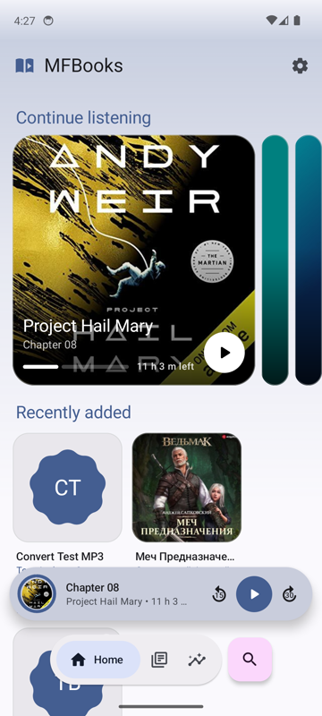
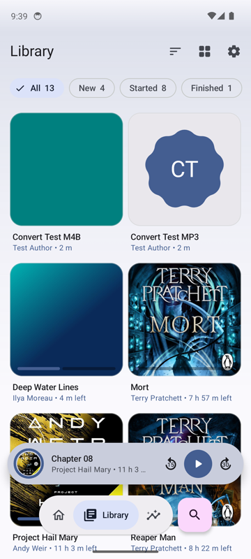
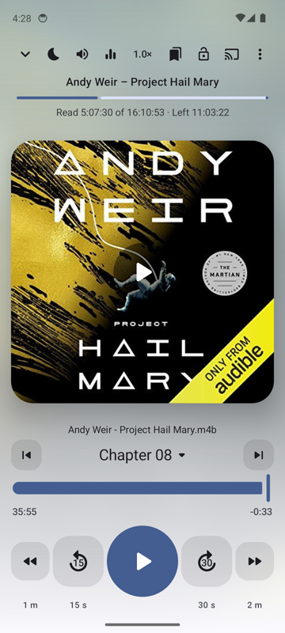

# MFBooks

A local-files audiobook player for Android, built with Jetpack Compose (Material 3 Expressive) and Media3.

<p>
  
  
  
</p>

## Features

- Every folder is a book: M4B/MP3/Opus and more, chapters from MP4/ID3/Vorbis tags, `.cue` and `.nfo` files
- Progress saved per book, per-book speed, volume boost, EQ and skip-silence
- Sleep timer with fade-out and shake-to-extend, smart auto-rewind, bookmarks, listening stats
- Android Auto, Bluetooth and notification controls, Chromecast
- Convert books to Opus to save space
- Imports progress and history from Smart AudioBook Player
- No account, no ads, no analytics

## Install

Download the APK from [Releases](../../releases/latest). Requires Android 10+.

## Build

```bash
./gradlew :app:assembleDebug
```
